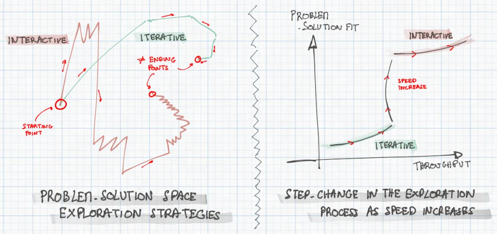

# Faster answers, better questions

Thinking about how programming and product building are being changed by the chatGPT, Cursor, Bolt and the likes:

- When you build dishwashers, 📈 increased speed = increased throughput 📈.

- But software and product development don’t have a fixed output: we're simultaneously discovering both the solution and refining our understanding of the problem itself. **We search through the problem-solution space 🔍**.

- It’s an ITERATIVE process: each cycle of building helps clarify the intent, leading to the next cycle.

- ⚡Increasing speed⚡, at first, will accelerate the process, but the path through the problem-solution space is unchanged.

- But when the response time falls below a certain threshold though, **the process switches to INTERACTIVE**: we stop planning ahead, we get started and let our hands do the thinking. It’s a fundamentally different search strategy (different path, different results) which, I would argue, produces **superior results as it requires less assumptions about the problem**.

- It feels like it's what GenAI / CodeGen tools are taking us to interactive land for at least part of the process. Already, building a simple prototype has become a conversation.

